# Dzhura

<p align="center">
  
</p>

<p>
  <a href="https://github.com/dvasyliev/dzhura-helper-bot/actions/workflows/ci.yml"></a>
  <a href="https://github.com/dvasyliev/dzhura-helper-bot/releases/latest"></a>
  <a href="https://core.telegram.org/bots"></a>
  <a href="https://github.com/dvasyliev/claude-plugins/tree/main/plugins/codebase-harness"></a>
  <a href="https://claude.com/claude-code"></a>
  <a href="#features"></a>
  <a href="#features"></a>
  <a href="#features"></a>
  <a href="#quick-start"></a>
  <a href="https://huggingface.co/patriotyk/HolosTTS"></a>
  <a href="https://huggingface.co/hexgrad/Kokoro-82M"></a>
  <a href="https://huggingface.co/mlx-community/whisper-large-v3-turbo"></a>
  <a href="https://github.com/nomadkaraoke/python-audio-separator"></a>
  <a href="LICENSE"></a>
</p>

<p>
  <a href="#features"><b>Features</b></a>
  &nbsp;&nbsp;&nbsp;
  <a href="#quick-start"><b>Quick start</b></a>
  &nbsp;&nbsp;&nbsp;
  <a href="#contributing"><b>Contributing</b></a>
</p>

A personal Telegram bot that runs on your own Mac. It sums up YouTube videos, translates and voices books, and makes karaoke from songs. It answers only its owner.

## Features

### 📝 YouTube video → Summary → Voice-over

Send a link to a YouTube video and get a summary in Ukrainian (and in English for an English video), brief or detailed, with times that link to that moment of the video. Then have it voiced: a woman's or a man's voice reads it to you.

### 📚 Book → Translation → Audiobook

Send an EPUB or PDF book. Translate it into Ukrainian from English or Russian, then voice the translation as an audiobook, an mp3 per chapter. A Ukrainian or English book can be voiced right away, and a text PDF can be turned into an EPUB.

### 🎤 YouTube song → Karaoke

Send a link to a YouTube song and get a karaoke video with the words lighting up as they are sung: music only, with the singer's vocals, or both. Works for English, Ukrainian and Russian songs.

### Where it runs

Voicing and karaoke run locally on Apple Silicon; translation and summaries go through Claude. Results can also go to a Telegram group of your own, a topic per book: [docs/library-group.md](docs/library-group.md). How each feature works inside: [docs/how-it-works.md](docs/how-it-works.md).

## Quick start

You need a Mac with Apple Silicon and about 6 GB for models.

```bash
brew install node uv
npm run setup   # Node and Python packages, and .env from .env.example
# fill in BOT_TOKEN and OWNER_ID in .env
npm start
```

That is enough for audiobooks. The other features need a program or two each (pandoc, ffmpeg, Claude Code); the bot marks the ones it lacks in its menu. Full guide: [SETUP.md](SETUP.md).

<!-- COURSES:START -->
## My Educational Courses

I teach developers what I use in production: practical, project-based courses on AI coding tools, Agentic AI, Vibe Coding and modern full-stack technologies. Every course builds on projects I ship and workflows I test first. Students learn what holds up in real work, from new framework releases to AI coding tools.

👨‍🎓 Taught **235,000+ students** across Udemy and Coursera, with a **4.4+ average rating**.<br/>
📚 Created **25+ courses** across AI coding, frontend, full-stack and modern developer tools.

#### AI Coding Courses

<p>
  <a href="https://go.dvasyliev.com/harness-engineering"></a>
  <a href="https://go.dvasyliev.com/evaluating-ai-code"></a>
  <a href="https://go.dvasyliev.com/cca-f"></a>
  <a href="https://go.dvasyliev.com/openclaw"></a>
  <a href="https://go.dvasyliev.com/claude-code"></a>
  <a href="https://go.dvasyliev.com/v0"></a>
  <a href="https://go.dvasyliev.com/gh300"></a>
  <a href="https://go.dvasyliev.com/lovable"></a>
  <a href="https://go.dvasyliev.com/cursor"></a>
  <a href="https://go.dvasyliev.com/copilot"></a>
</p>

#### Web Development Courses

<p>
  <a href="https://go.dvasyliev.com/nodejs"></a>
  <a href="https://go.dvasyliev.com/nextjs"></a>
  <a href="https://go.dvasyliev.com/ai-chatbot"></a>
  <a href="https://go.dvasyliev.com/react"></a>
</p>

[See more courses →](https://www.dvasyliev.com/courses)
<!-- COURSES:END -->

## Contributing

Have a question, found a bug or have an idea? [Open an issue](https://github.com/dvasyliev/dzhura-helper-bot/issues). Pull requests are welcome. Commit rules and how the code is laid out: [CLAUDE.md](CLAUDE.md). What changed in each version: [CHANGELOG.md](CHANGELOG.md) and [Releases](https://github.com/dvasyliev/dzhura-helper-bot/releases). Security issues: [SECURITY.md](SECURITY.md).

## License

[MIT](LICENSE) © Dmytro Vasyliev

The [calque tables](src/features/translate/lang/uk/russianisms/) are vendored from [chysto-ukr-skills](https://github.com/vladichumachenko/chysto-ukr-skills) (MIT) and include LanguageTool data (LGPL 2.1); their licences are in that folder.
